<p align="center">
  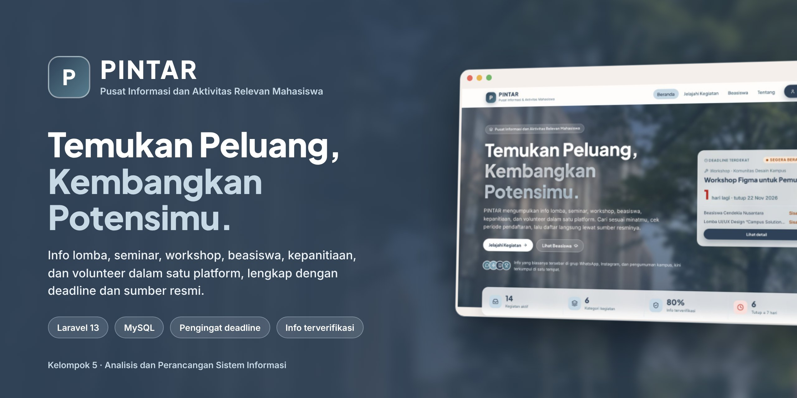
</p>

<h1 align="center">PINTAR</h1>
<p align="center"><b>Pusat Informasi dan Aktivitas Relevan Mahasiswa</b><br>
Satu tempat untuk info lomba, seminar, workshop, beasiswa, kepanitiaan, dan volunteer, lengkap dengan deadline, pengingat, dan sumber resmi.</p>

<p align="center">
  
  
  
  
  
</p>

<p align="center">
  <a href="https://jundyganteng20.github.io/PINTAR-app/"><b>Lihat Prototype UI</b></a> ·
  <a href="#cara-menjalankan"><b>Cara Menjalankan</b></a> ·
  <a href="#diagram-uml"><b>Diagram UML</b></a>
</p>

---

## Daftar Isi

- [Tentang PINTAR](#tentang-pintar)
- [Fitur Utama](#fitur-utama)
- [Tangkapan Layar](#tangkapan-layar)
- [Diagram UML](#diagram-uml)
- [Teknologi](#teknologi)
- [Struktur Folder](#struktur-folder)
- [Cara Menjalankan](#cara-menjalankan)
- [Pengujian](#pengujian)
- [Deploy](#deploy)
- [Tim & Kontribusi](#tim--kontribusi)

---

## Tentang PINTAR

**Masalahnya:** info lomba, seminar, workshop, dan beasiswa biasanya dibagikan di grup WhatsApp kelas, angkatan, dan prodi. Karena tersebar, mahasiswa harus mencari dan menyaring sendiri. Pesan baru membuat info lama tertumpuk, sehingga sulit tahu apakah pendaftaran masih buka, dan banyak kesempatan akhirnya terlewat.

**Solusinya:** PINTAR memusatkan semua info kegiatan dalam satu platform web. Setiap kegiatan menampilkan periode pendaftaran, sisa hari, persyaratan, kontak, dan tautan ke **sumber resmi**. Admin/pengelola menandai info yang sudah dicek dengan lencana **Terverifikasi**.

| Pengguna | Yang bisa dilakukan |
|---|---|
| **Mahasiswa** | Mencari dan memfilter kegiatan, melihat detail dan beasiswa, membuka sumber resmi, serta menyimpan pengingat deadline (perlu akun) |
| **Admin/Pengelola** | Menambah, mengubah, menghapus, dan memverifikasi informasi kegiatan, termasuk mengunggah poster |

> PINTAR tidak menerima pendaftaran. Mahasiswa mendaftar langsung melalui tautan sumber resmi penyelenggara.

---

## Fitur Utama

| Fitur | Keterangan | Kebutuhan |
|---|---|---|
| Beranda | Deadline terdekat, statistik, 6 kategori, kegiatan yang segera ditutup, dan beasiswa | FR-04, FR-05, FR-10, FR-12 |
| Pencarian & filter | Kata kunci, jenis (Akademik/Non-akademik), multi-kategori, multi-bidang minat, status, dan terverifikasi | FR-07, FR-08, FR-09, FR-13, FR-14 |
| Detail kegiatan | Poster, persyaratan, periode dan sisa hari, kontak (tombol salin), dan sumber resmi | FR-02, FR-04, FR-06, FR-11, FR-15, FR-17 |
| Beasiswa | Daftar beasiswa beserta kriteria, periode, dan situs resmi penyedia | FR-01, FR-02, FR-03 |
| Pengingat deadline | Simpan pengingat dengan ikon lonceng, halaman Pengingatku, dan banner untuk yang tutup ≤ 3 hari | FR-05 |
| Verifikasi informasi | Lencana Terverifikasi, ditandai admin setelah dicocokkan dengan sumber resmi | FR-16 |
| Akun | Registrasi dan login mahasiswa, login admin | pendukung FR-05 |
| Kelola (admin) | Tambah, ubah, hapus, unggah poster, dan validasi isian dalam Bahasa Indonesia | peran admin |

---

## Tangkapan Layar

### Beranda
<p align="center">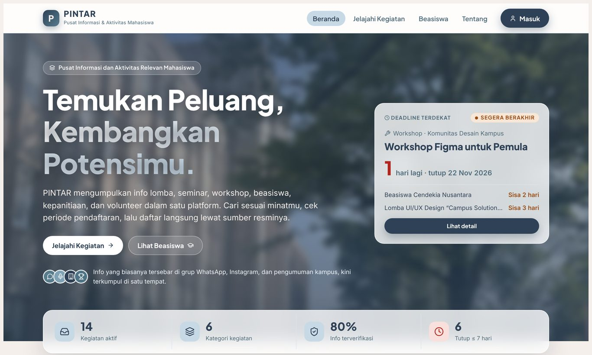</p>

<table>
  <tr>
    <td width="50%">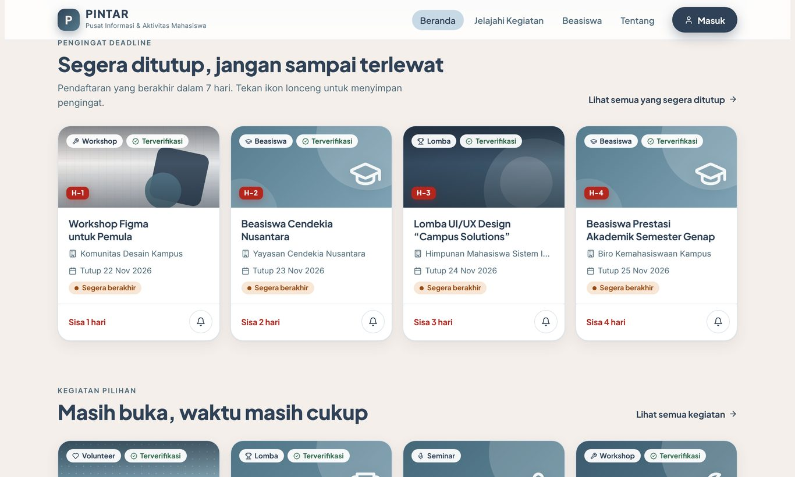<p align="center"><b>Segera ditutup</b>: label H-n dan tombol pengingat</p></td>
    <td width="50%">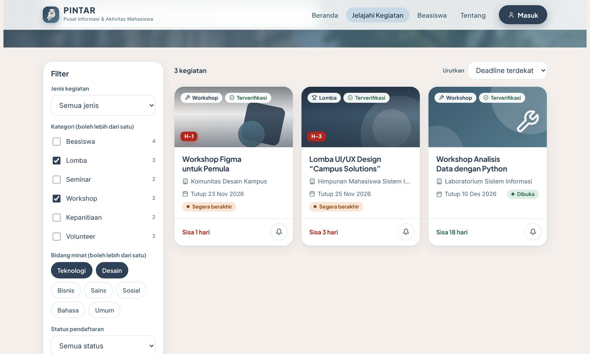<p align="center"><b>Jelajahi</b>: filter multi-kategori dan bidang minat</p></td>
  </tr>
  <tr>
    <td>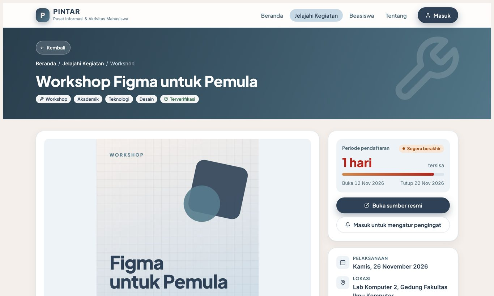<p align="center"><b>Detail</b>: poster, periode, dan sisa hari</p></td>
    <td>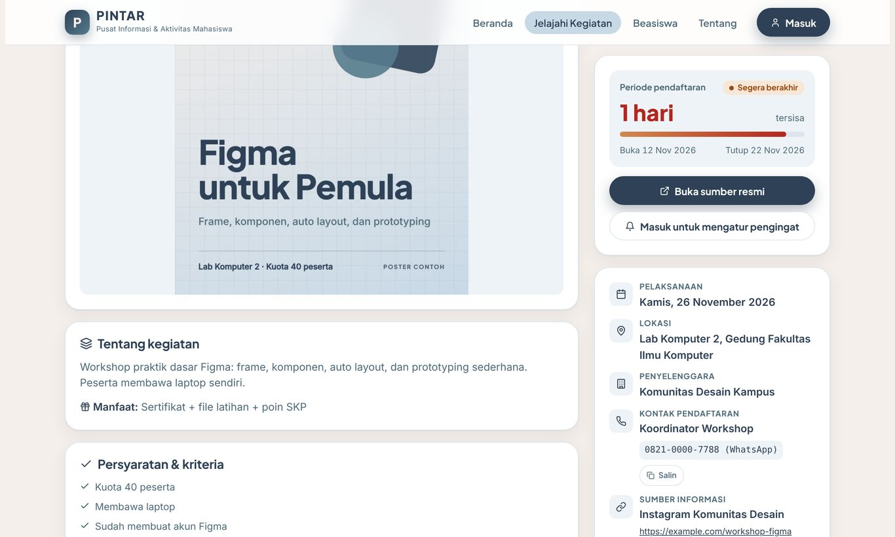<p align="center"><b>Detail</b>: kontak, sumber resmi, dan verifikasi</p></td>
  </tr>
  <tr>
    <td>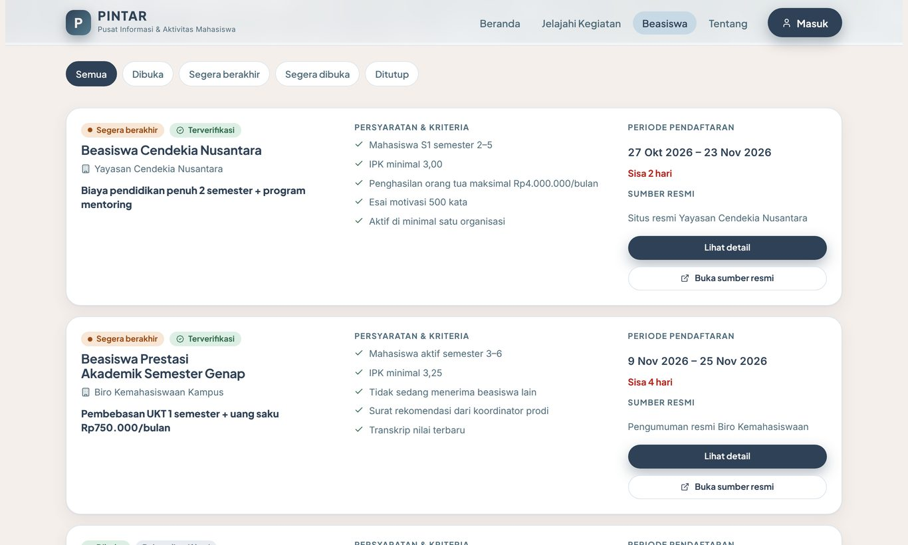<p align="center"><b>Beasiswa</b>: kriteria dan sumber penyedia</p></td>
    <td>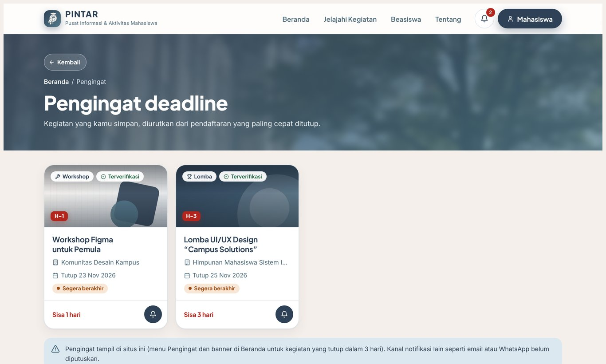<p align="center"><b>Pengingatku</b>: daftar deadline yang disimpan</p></td>
  </tr>
  <tr>
    <td>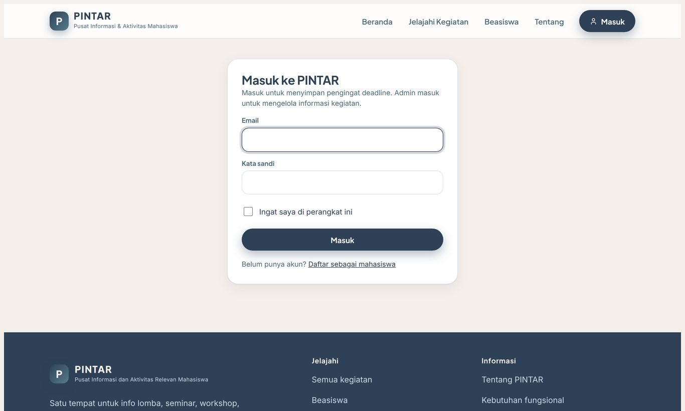<p align="center"><b>Login</b></p></td>
    <td>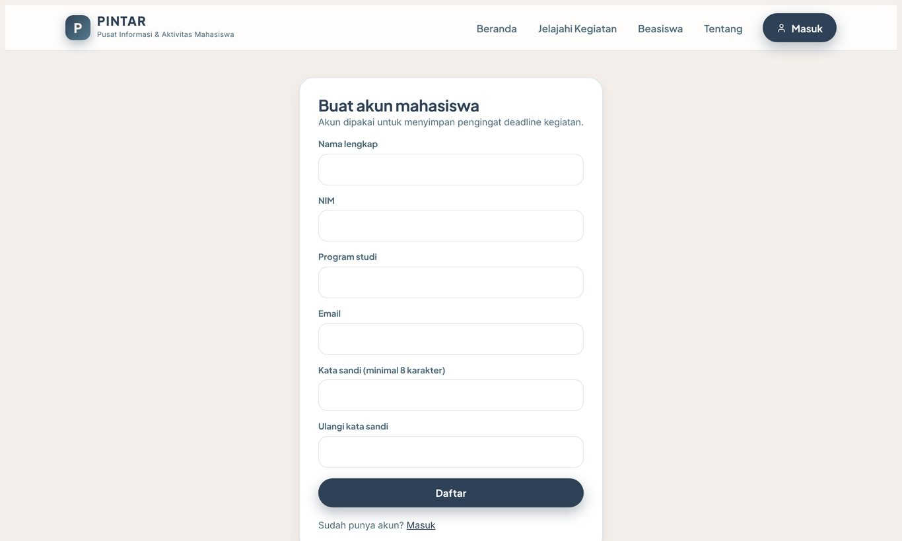<p align="center"><b>Registrasi mahasiswa</b></p></td>
  </tr>
</table>

### Admin/Pengelola

<table>
  <tr>
    <td width="50%">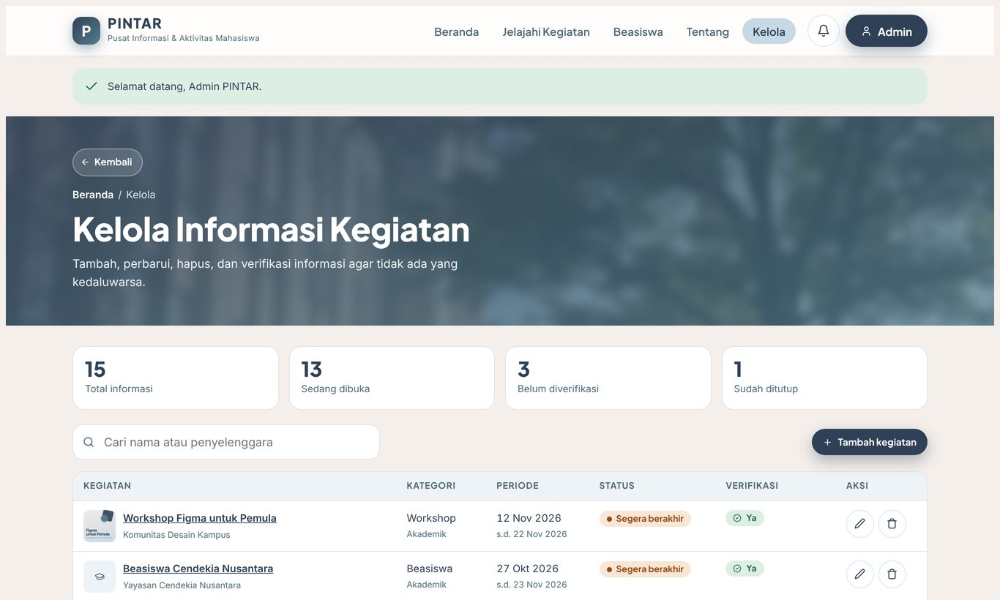<p align="center"><b>Kelola</b>: ringkasan, verifikasi, ubah, dan hapus</p></td>
    <td width="50%">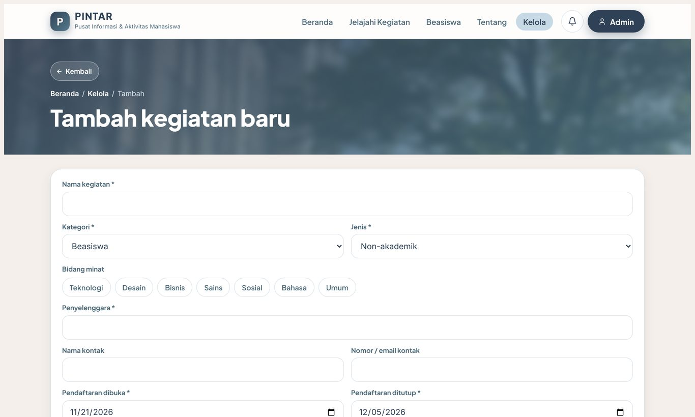<p align="center"><b>Form tambah kegiatan</b></p></td>
  </tr>
  <tr>
    <td>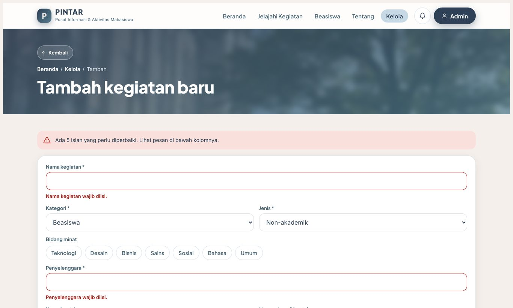<p align="center"><b>Validasi</b>: pesan di bawah kolom yang salah</p></td>
    <td align="center">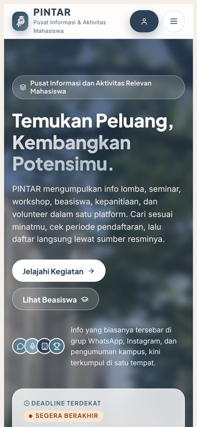 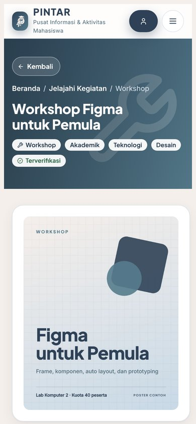<p align="center"><b>Responsif</b> di ponsel</p></td>
  </tr>
</table>

> Nama kegiatan, tanggal, kontak, dan tautan pada tangkapan layar adalah **data ilustrasi**.

---

## Diagram UML

### Use Case Diagram
<p align="center">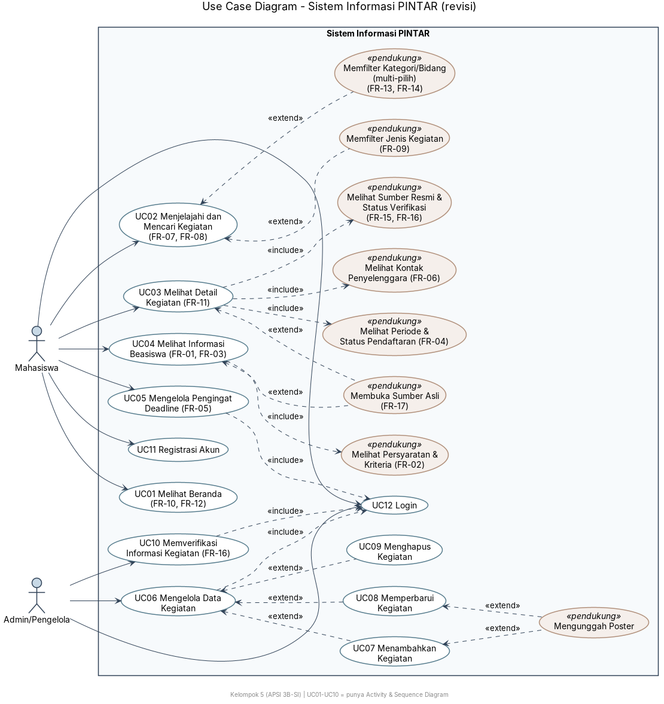</p>

### Class Diagram
Nama atribut dan operasi sama dengan model di `app/Models`.
<p align="center">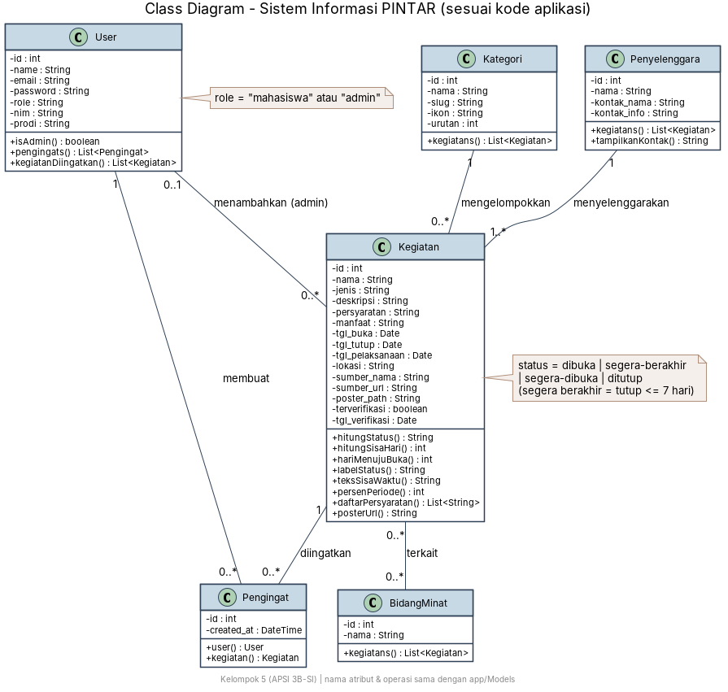</p>

### Entity Relationship Diagram (ERD)
Sesuai tabel di `database/migrations`.
<p align="center">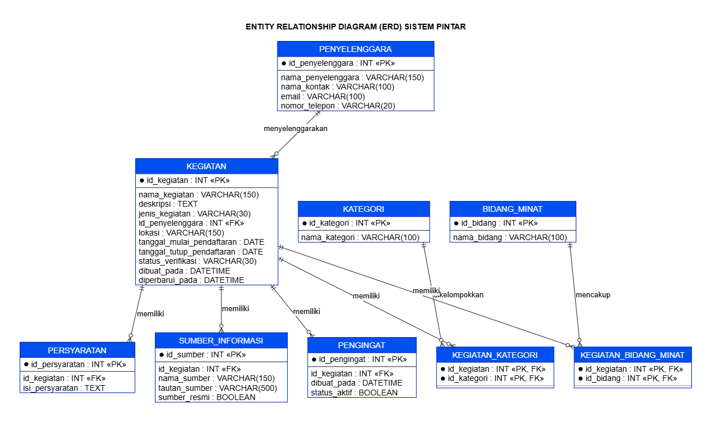</p>

### Activity & Sequence Diagram

| UC | Use case | Activity | Sequence |
|---|---|---|---|
| UC01 | Melihat Beranda | [lihat](assets/uml/activity/activity-uc01.png) | [lihat](assets/uml/sequence/sequence-uc01.png) |
| UC02 | Menjelajahi dan Mencari Kegiatan | [lihat](assets/uml/activity/activity-uc02.png) | [lihat](assets/uml/sequence/sequence-uc02.png) |
| UC03 | Melihat Detail Kegiatan | [lihat](assets/uml/activity/activity-uc03.png) | [lihat](assets/uml/sequence/sequence-uc03.png) |
| UC04 | Melihat Informasi Beasiswa | [lihat](assets/uml/activity/activity-uc04.png) | [lihat](assets/uml/sequence/sequence-uc04.png) |
| UC05 | Mengelola Pengingat Deadline | [lihat](assets/uml/activity/activity-uc05.png) | [lihat](assets/uml/sequence/sequence-uc05.png) |
| UC06 | Mengelola Data Kegiatan | [lihat](assets/uml/activity/activity-uc06.png) | [lihat](assets/uml/sequence/sequence-uc06.png) |
| UC07 | Menambahkan Kegiatan | [lihat](assets/uml/activity/activity-uc07.png) | [lihat](assets/uml/sequence/sequence-uc07.png) |
| UC08 | Memperbarui Kegiatan | [lihat](assets/uml/activity/activity-uc08.png) | [lihat](assets/uml/sequence/sequence-uc08.png) |
| UC09 | Menghapus Kegiatan | [lihat](assets/uml/activity/activity-uc09.png) | [lihat](assets/uml/sequence/sequence-uc09.png) |
| UC10 | Memverifikasi Informasi Kegiatan | [lihat](assets/uml/activity/activity-uc10.png) | [lihat](assets/uml/sequence/sequence-uc10.png) |

<details>
<summary><b>Tampilkan contoh: Activity & Sequence UC03 Melihat Detail Kegiatan</b></summary>
<p align="center">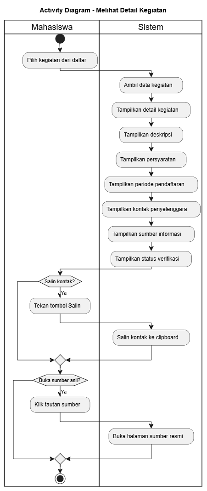 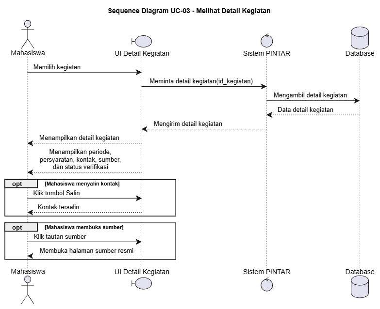</p>
</details>

Kode PlantUML untuk Use Case, Class, dan ERD ada di `assets/uml/*.puml`.

---

## Teknologi

| Bagian | Teknologi |
|---|---|
| Backend | Laravel 13, PHP 8.3+ |
| Database | MySQL / MariaDB (SQLite untuk uji lokal dan tes) |
| Tampilan | Blade, CSS buatan sendiri (palet Navy, Teal, Sky Blue, Beige), font Plus Jakarta Sans & Inter |
| Pengujian | PHPUnit (22 tes) |
| Prototype UI | HTML statis di GitHub Pages (folder `docs/`) |

---

## Struktur Folder

| Lokasi | Isi |
|---|---|
| `app/Models` | `Kegiatan` (dengan `hitungStatus()`, `hitungSisaHari()`), `Kategori`, `BidangMinat`, `Penyelenggara`, `Pengingat`, `User` |
| `app/Http/Controllers` | Beranda, Jelajahi/Detail/Beasiswa, Pengingat, Login/Registrasi, Admin |
| `database/migrations` | Tabel `kategoris`, `bidang_minats`, `penyelenggaras`, `kegiatans`, `pengingats` |
| `database/seeders` | Data awal: kategori, bidang minat, 15 kegiatan contoh, akun contoh |
| `resources/views` | Tampilan semua halaman |
| `public/css/pintar.css` | Gaya tampilan |
| `tests/` | Tes otomatis |
| `docs/` | Prototype UI untuk GitHub Pages |
| `assets/` | Gambar README dan diagram UML |

---

## Cara Menjalankan

Butuh **PHP 8.3+** dan **Composer**. Di Windows paling mudah pakai [Laravel Herd](https://herd.laravel.com) atau XAMPP.

```bash
git clone https://github.com/JUNDYGANTENG20/PINTAR-app.git
cd PINTAR-app
composer install
cp .env.example .env
php artisan key:generate
```

**Pilih database:**

- **SQLite (paling cepat, tanpa MySQL):** di `.env` ubah `DB_CONNECTION=sqlite`, beri `#` di depan baris `DB_HOST` sampai `DB_PASSWORD`, lalu buat file kosong `database/database.sqlite`.
- **MySQL:** buat database `pintar`, lalu isi `DB_USERNAME` dan `DB_PASSWORD` di `.env`.

```bash
php artisan migrate --seed
php artisan storage:link
php artisan serve
```

Buka **http://localhost:8000**. Pengguna Herd bisa langsung membuka `http://pintar-app.test`.

**Atau tanpa instal apa pun:** klik **Code → Codespaces → Create codespace on main**, tunggu sampai muncul "PINTAR siap", lalu buka port **8000**.

### Akun contoh

| Peran | Email | Kata sandi |
|---|---|---|
| Admin | admin@pintar.test | admin12345 |
| Mahasiswa | mahasiswa@pintar.test | mahasiswa123 |

> Akun dan kegiatan dari seeder hanya untuk uji coba. Ganti dengan data resmi sebelum dipakai sungguhan.

---

## Pengujian

```bash
php artisan test
```

Tes memakai SQLite di memori dan mencakup perhitungan status pendaftaran, pencarian dan filter, halaman detail, registrasi dan login, pengingat, hak akses admin, serta tambah, ubah, hapus, dan verifikasi kegiatan beserta unggah poster.

---

## Deploy

Aplikasi butuh hosting yang mendukung **PHP 8.3+ dan MySQL** (misalnya Niagahoster atau InfinityFree). GitHub Pages hanya menampilkan **prototype UI** dari folder `docs/`.

Langkah umum di hosting dengan terminal:

```bash
composer install --no-dev --optimize-autoloader
php artisan migrate --force --seed
php artisan storage:link
php artisan pintar:buat-admin email-admin@kampus.ac.id --nama="Nama Pengelola"
```

Atur `.env`: `APP_ENV=production`, `APP_DEBUG=false`, `APP_URL`, dan kredensial database. Untuk hosting tanpa symlink, tambahkan `PUBLIC_DISK_IN_PUBLIC=true`.

---

## Tim & Kontribusi

**Kelompok 5 · Analisis dan Perancangan Sistem Informasi · 3B-SI · Universitas Singaperbangsa Karawang**

| Anggota | Peran | Kontribusi | Kontak |
|---|---|---|---|
| **Regina Martha Secunda** | Ketua kelompok | Mengoordinasi tim, menyusun studi kelayakan, analisis kebutuhan, pemodelan dan perancangan sistem, serta bab penutup laporan. | [@reginamarthase](https://instagram.com/reginamarthase) |
| **Aqila Al-Jundy** | Pengembang sistem | Membangun prototype UI dan aplikasi web PINTAR (Laravel + MySQL), mengelola repositori dan GitHub Pages, menyusun bab implementasi, serta menguji sistem. | [@aqjwndy](https://instagram.com/aqjwndy) · [GitHub](https://github.com/JUNDYGANTENG20) |
| **Bunga Aulia Raya** | Analis kebutuhan | Menyusun studi kelayakan, analisis kebutuhan, dan bab implementasi, serta menguji sistem. | [@lynnryy__](https://instagram.com/lynnryy__) |
| **Radhin Ramadhan Hendestian** | Pengembang sistem | Membantu membangun sistem, menyusun bab implementasi dan pengujian, serta menguji sistem. | [@radhin.smh](https://instagram.com/radhin.smh) |
| **Talitha Nailal Husna** | Analis & pemodelan | Menyusun pendahuluan, analisis kebutuhan, pemodelan sistem (diagram UML), dan lampiran laporan. | [@litha.docx](https://instagram.com/litha.docx) |

### Ringkasan kontribusi per tahap

| Tahap | Regina | Aqila | Bunga | Radhin | Talitha |
|---|:-:|:-:|:-:|:-:|:-:|
| Pendahuluan | | | | | ✓ |
| Studi kelayakan | ✓ | | ✓ | | |
| Analisis kebutuhan | ✓ | | ✓ | | ✓ |
| Pemodelan & perancangan (UML, ERD) | ✓ | | | | ✓ |
| Prototype UI & aplikasi web | | ✓ | | ✓ | |
| Implementasi (laporan) | | ✓ | ✓ | ✓ | |
| Pengujian sistem | | ✓ | ✓ | ✓ | |
| Penutup & lampiran | ✓ | | | | ✓ |

---

<p align="center"><sub>Data kegiatan, tanggal, kontak, dan tautan dalam aplikasi ini adalah data ilustrasi untuk keperluan tugas.</sub></p>
